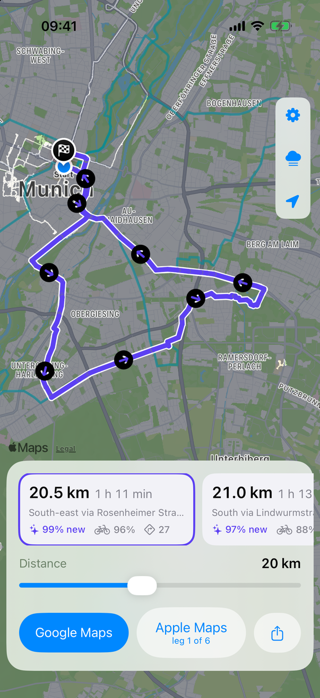
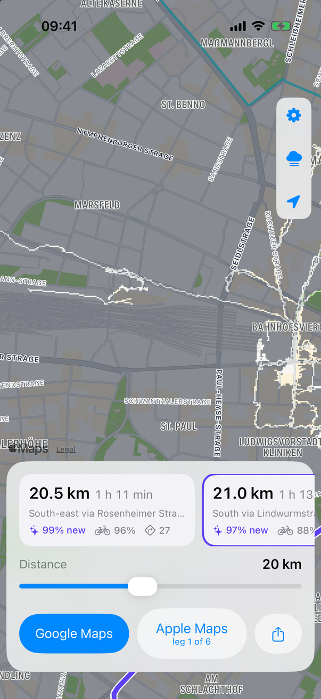
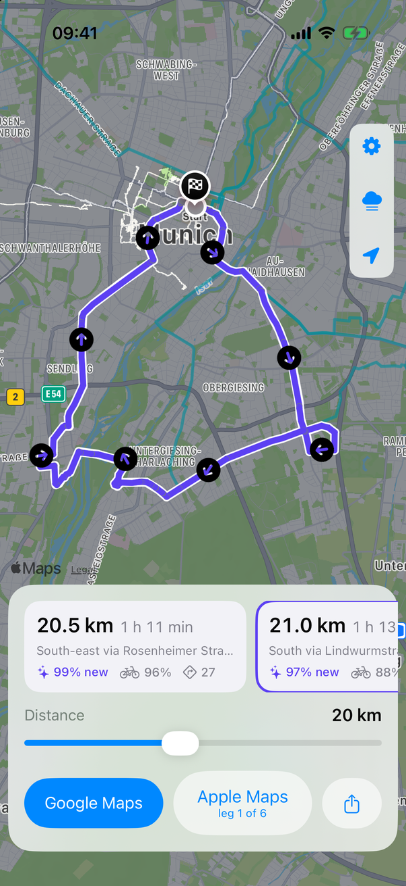

# FogRide

An iOS app that plans cycling loops through places you haven't uncovered in
[Fog of World](https://fogofworld.app/en/) yet.

Website: <https://tslmy.github.io/fogride/>

  
  
  

Open the app and it proposes up to four loops that start and end where you are. A slider sets
how far you want to ride. Each loop shows its length, estimated time, share of road that is
still under fog, share on bike lanes or paths, and number of turns. The map shows your fog,
drawn from Fog of World's own data.

FogRide is an independent hobby project, not affiliated with or endorsed by Fog of World or
its maker, Ollix.

## Running it on your phone

1. Open `FogRide.xcodeproj` in Xcode.
2. Select the FogRide target, then Signing & Capabilities, and choose your team. Change the
   bundle identifier (`dev.fogride.FogRide`) if Xcode says it is taken.
3. Plug in your iPhone, pick it as the run destination, and press Run.

## Connecting Fog of World

iOS does not let one app read another app's private storage, so FogRide reads the `Sync`
folder that Fog of World keeps in iCloud Drive or Dropbox. On first launch, tap
**Choose Sync Folder** and pick that folder (or the folder containing it) in the Files picker.
The app remembers the folder and re-reads it on every launch, so new rides show up once Fog of
World has synced. The data is only read, never written.

Alternatively, copy a `Sync` folder into the app's own folder (Files > On My iPhone > FogRide).
It is picked up automatically when no folder has been chosen.

## How routes are chosen

- Roads come from OpenStreetMap (Overpass API). The public servers take 35-50 s to answer
  however small the request, so the app downloads one 28 km square around you and keeps it:
  every ride length, and any start within several kilometers, then works without a download.
  Saved roads are reused whatever their age and refreshed in the background after 30 days.
- Every road segment is mapped onto "exposure cells" of 3 x 3 Fog of World cells (about 23 m).
  A cell counts as seen if any part of it is uncovered, and a loop only gets credit for each
  fogged cell once, so the two sides of a divided road, or a road beside a path you've
  ridden, don't count as new twice.
- Candidate loops are built by placing two to four waypoints around a circle through the start,
  biased toward the foggiest neighborhoods, and joining them with cheapest paths. The path cost
  penalizes already-uncovered road, roads without bike infrastructure, turns, U-turns, and
  riding a segment twice. The circle is resized until the loop is close to the requested length.
- Hairpins and out-and-back spurs are cut, loops are scored, and the best few that differ from
  each other are shown.

The weights live in `PlannerWeights` in `FogRide/Core/Planner.swift`.

## Sending a route to a navigation app

- **Google Maps** gets the whole loop as nine via-points in cycling mode.
- **Apple Maps** only supports multi-stop routes for driving, so the loop is handed over one
  leg at a time: each tap opens cycling directions to the next point on the loop.
- **Share** exports a GPX file with the exact track, for apps that can follow one (Komoot,
  Ride with GPS, Strava, and so on).

Google Maps and Apple Maps route between the via-points their own way, so what they navigate
can differ from the line FogRide drew. GPX is the only exact handoff.

## Layout

- `FogRide/Core/FogMap.swift` reads Fog of World tiles.
- `FogRide/Core/Overpass.swift` downloads and caches roads.
- `FogRide/Core/RoadGraph.swift` builds the bike network and classifies roads.
- `FogRide/Core/Planner.swift` generates and scores loops.
- `FogRide/RouteExport.swift` hands routes to other apps.
- `FogRide/FogTileOverlay.swift` draws the fog veil; `FogRide/RouteMapView.swift` is the map.
- `FogRide/AppModel.swift` and `FogRide/ContentView.swift` are the app itself.
- `docs/` is the website; `tools/make_icon.py` draws the app icon.

The Debug configuration is compiled with optimization on, because route planning is roughly
500 times slower without it.
